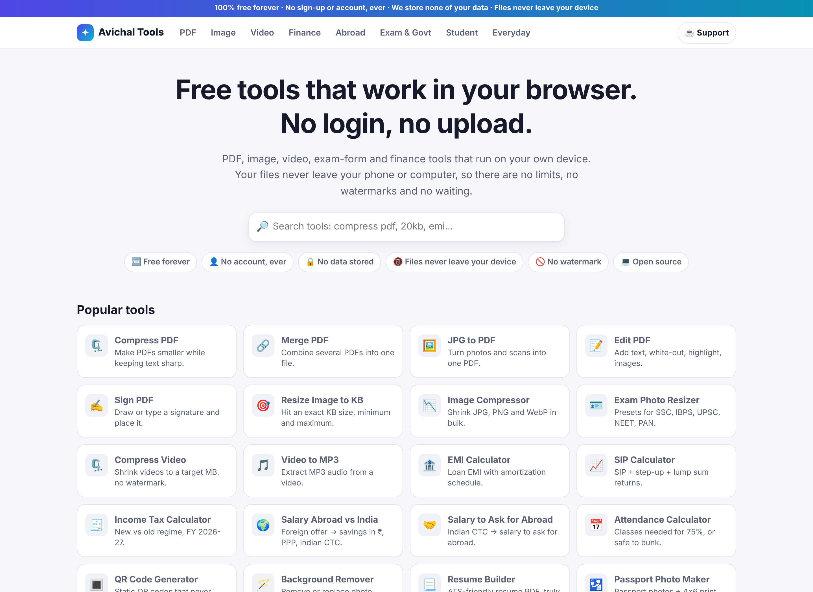
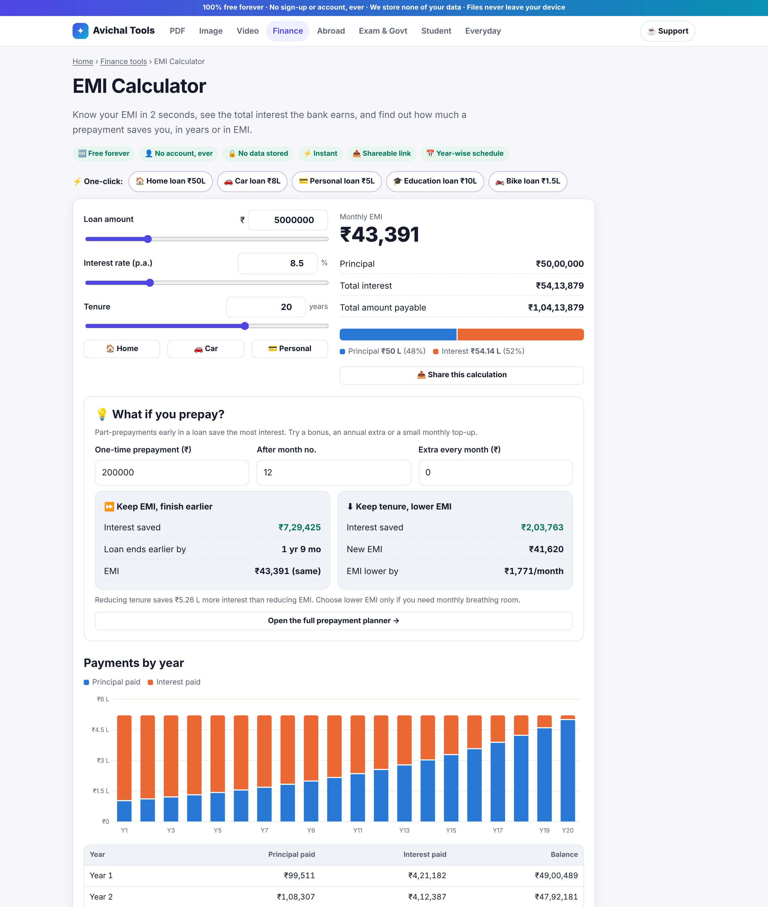
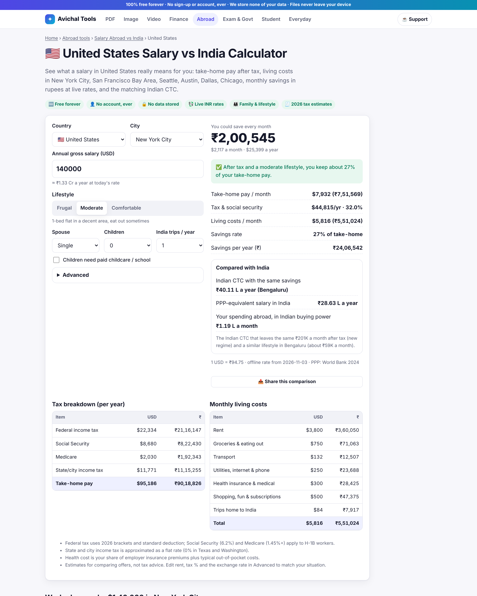
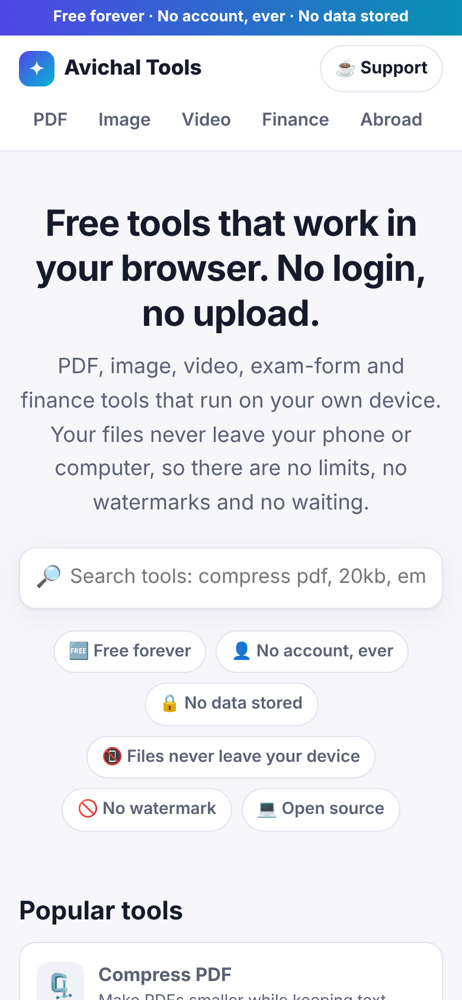
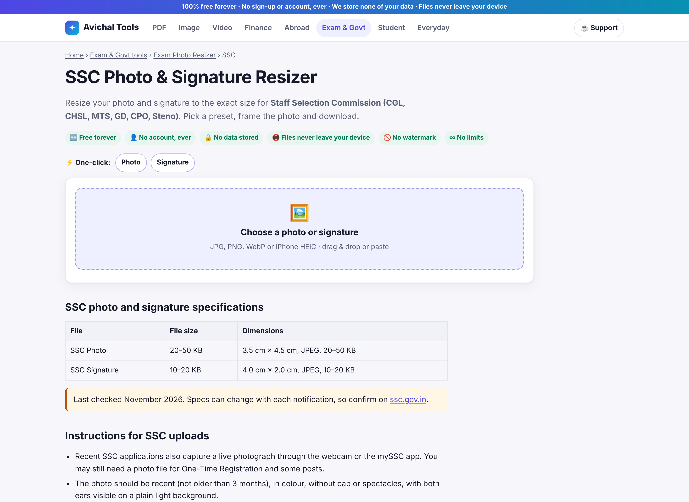
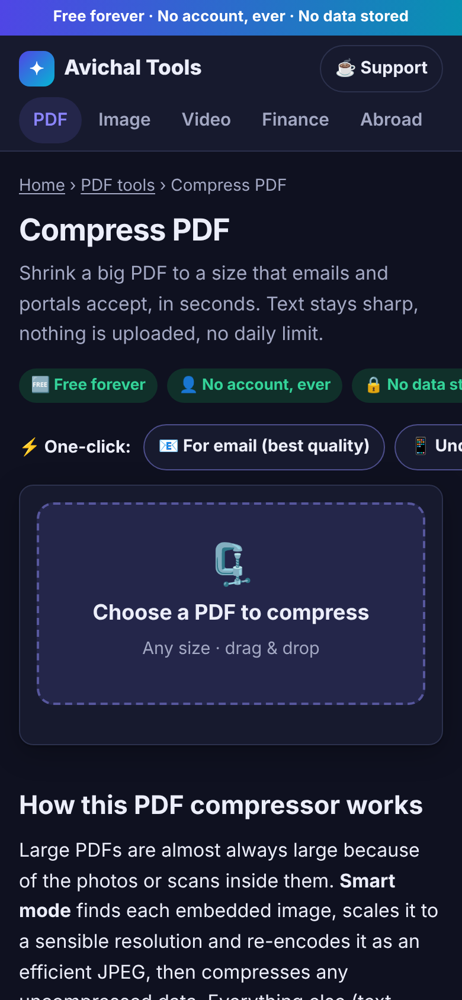
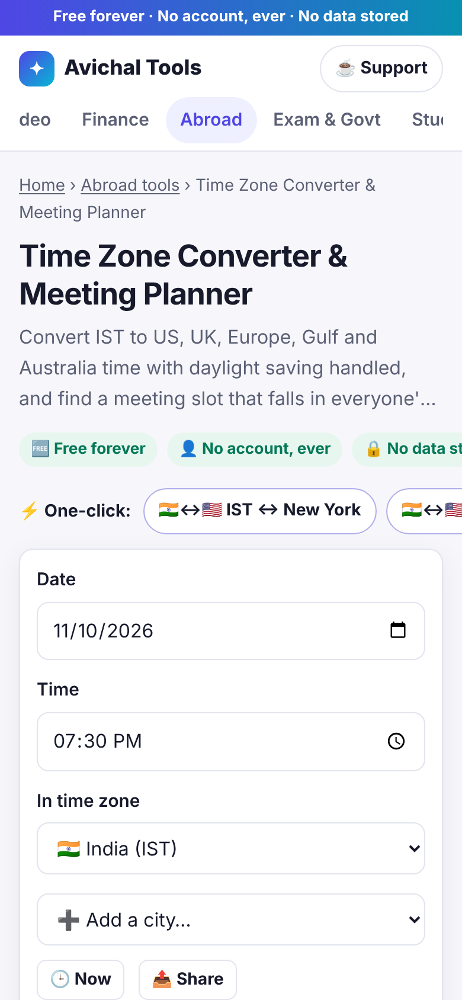

# SaralKit

**Free, open-source tools that run 100% in your browser. No login, no upload, no watermark.**

PDF, image, video, exam-form and finance tools. Your files never leave your device: everything is processed locally with WebAssembly and WebCodecs, so there are no servers to pay for, no limits, and nothing to leak.

## Screenshots

| Home | EMI with prepayment | Salary abroad vs India |
|---|---|---|
|  |  |  |

| Phone | Exam photo resizer | Dark mode | Time zone planner |
|---|---|---|---|
|  |  |  |  |

## What's inside (83 tools, 674 pages, 6 languages)

Every tool shows the promise up front (**🆓 free forever · 👤 no account, ever · 🔒 no data stored**) and offers **⚡ one-click presets** for the most common jobs. The home page, category pages, every tool and the exam and KB-size pages are available in **English, हिन्दी, বাংলা, मराठी, తెలుగు and தமிழ்** (`/hi`, `/bn`, `/mr`, `/te`, `/ta`), e.g. `/hi/ssc-photo-resizer`, `/ta/compress-image-to-20kb`.

| Category | Tools |
|---|---|
| **PDF** (13 + 7 pages) | Compress (smart or pages-to-images, **auto-fit a target size**, `/compress-pdf-to-{100kb…2mb}`), Merge, Split, JPG→PDF, PDF→JPG, Rotate, Organize, Page numbers, Watermark, **Sign PDF**, **Edit PDF** (edit existing text, fill form fields, draw, tick, white-out, highlight, true redaction, undo), **Unlock PDF** (incl. e-Aadhaar helper page), **Protect PDF** (AES-256) |
| **Image** (11) | **Resize to exact KB** (min + max, DPI, padding), Compressor (TinyPNG-style PNG), Resizer, Crop (circle), HEIC→JPG, PNG↔JPG, WebP→JPG, Converter, **Background remover** (on-device AI), **Image to text / OCR** (English + Hindi) |
| **Exam & Govt** (3 + 13 pages) | Exam photo & signature resizer with presets for **SSC, IBPS/SBI, UPSC, NEET, JEE Main, PAN**, signature cleaner, **Passport photo maker** (white background, 4×6 print sheet), `/compress-image-to-{10…500}kb` pages |
| **Video** (8) | **Compress** (quality or target MB), Trim, Video→MP3/M4A/WAV, MOV/MKV/WebM→MP4, Mute, **Screen recorder**, **Video→GIF**, **MP3 cutter & ringtone maker** |
| **Finance** (28 + 6 loan pages) | EMI (with a "what if you prepay?" panel), **Loan prepayment** (tenure saved vs EMI saved), Loan eligibility, Balance transfer, Compare loan offers, Home/car/personal/education/bike/gold loan EMI pages, SIP (step-up), Lumpsum, SWP, RD, FD, PPF, CAGR, EPF, Sukanya Samriddhi, Gratuity, **NPS (Dec 2025 exit rules)**, **Retirement planner**, Compound and simple interest, Inflation, **Income tax FY 2026-27 new vs old**, **Salary CTC → in-hand**, HRA, GST 2.0, **GST invoice**, **Quotation** (convert to invoice in one click), **Salary slip** and **Rent receipt** generators |
| **Abroad** (4 + 23 pages) | **Salary abroad vs India** (tax, living costs by lifestyle and family size, savings in ₹ at live rates, PPP, equivalent Indian CTC) with 12 country pages, Salary to ask for abroad, Live currency converter with 11 pair pages, **Time zone converter & meeting planner** |
| **Student** (4) | Attendance (75% rule), CGPA→percentage, Text→handwriting (Hindi support), **Resume builder** (ATS-friendly PDF) |
| **Everyday** (12) | QR code generator (static, never expires, logo), UPI QR poster, Word counter, Age calculator, Percentage, Discount, Number→words (lakh/crore), **Unit converter** (gaj, bigha, marla, cent, guntha), BMI (Indian cut-offs), Days between dates, Password generator, JSON formatter |

## Tech
- **[Astro](https://astro.build)** static site: every tool is its own SEO-friendly HTML page; about 6 KB of JS loads up front per page.
- **pdf-lib** (edit PDFs) + **pdf.js** (render PDFs), **Mediabunny** + WebCodecs (video/audio, hardware-accelerated, no ffmpeg.wasm), **libheif** (HEIC), **Tesseract.js** (OCR), **MediaPipe** selfie segmentation (background removal), **qrcode**, **gifenc**, **UPNG**, **fflate**.
- No framework runtime, no backend, no database. Deploys to **Cloudflare** for free.
- **qpdf** (WebAssembly, in a worker) for PDF passwords; six languages from one codebase (`src/i18n/`).
- Search that lands on the exact page: `/search?q=` redirects to the best match; Chrome site search via OpenSearch.
- Optional privacy-first **PostHog** analytics with ready-made AARRR dashboards (overall, per category, per tool, by language).

## Quick start

```bash
npm install
```

```bash
npm run dev
```

Open http://localhost:4321. Ad placeholders are visible in dev.

```bash
npm run build && npm run preview
```

### Tests

```bash
npm run test:unit
```

```bash
npm run build && npm run test:e2e
```

The e2e suite serves `dist/` and drives every tool in headless Chromium with real PDFs, photos, HEIC and MP4/MOV files (fixtures: `node tests/make-fixtures.mjs` plus ffmpeg; see `tests/`).

## Configure
Everything brand- or money-related lives in **`src/config/site.ts`** (or environment variables at build time):
`SITE_URL`, `ADSENSE_CLIENT`, `ADSENSE_SLOT_*`, `POSTHOG_KEY`, `POSTHOG_HOST`, `EST_ECPM_USD`, `CF_ANALYTICS_TOKEN`, `GA4_ID`, `UPI_ID`, plus donation links.

## Docs
- 📈 [`docs/STRATEGY.md`](docs/STRATEGY.md): the ranked tool list (volume × paywall pain × ease), build order and revenue levers.
- ☁️ [`docs/DEPLOY-CLOUDFLARE.md`](docs/DEPLOY-CLOUDFLARE.md): step-by-step deploy, custom domain, Search Console, AdSense.
- ✅ [`docs/CHECKLIST.md`](docs/CHECKLIST.md): SEO, hosting, database, APIs, ads, licences, donations, legal, and what only you can do.
- 📊 [`docs/ANALYTICS.md`](docs/ANALYTICS.md): PostHog setup, one-command dashboards, metric definitions and a weekly review routine.
- 🧩 [`docs/ADDING-A-TOOL.md`](docs/ADDING-A-TOOL.md): add a new tool in about 30 minutes.

## Project structure
```
src/
  config/site.ts        brand, URL, contact, ads, analytics, donations
  data/tools.ts         registry of all tools (nav, home, hubs, sitemap, related tools)
  i18n/                 languages: ui-en.ts (source strings) + lang/{hi,bn,mr,te,ta}.ts
  data/exams.ts         exam photo/signature specs + KB landing pages
  layouts/              Base (head/SEO/header/footer), ToolLayout (schema, FAQ, ads), Page
  components/           Dropzone, AdSlot, KbResizer, BatchImage, VideoTool, PageEditor, SliderField…
  lib/                  ui, image, pdf, media, finance, abroad, analytics, format, charts, qr helpers
  tools/                client-side logic per tool (lazy-loaded)
  pages/                one .astro file per URL (+ [exam]-photo-resizer, compress-image-to-[kb]kb,
                        [loan]-loan-emi-calculator, salary-in-[country]-vs-india, [pair], [hub],
                        compress-pdf-to-[size], [lang]/ for translated pages)
scripts/                asset copy, icon generation, PostHog dashboard builder
public/                 _headers, _redirects, sw.js, icons, og.png
tests/                  unit + e2e (Playwright) tests and fixtures
```

## Contributing
Bug reports and tool requests: open an issue or email **jokars.v1@gmail.com**. Please never attach private documents; describe them instead.

## License
[MIT](LICENSE). Third-party licences: [THIRD_PARTY_LICENSES.md](THIRD_PARTY_LICENSES.md).
